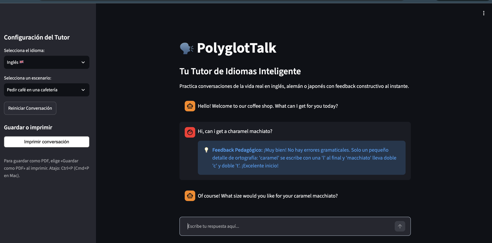
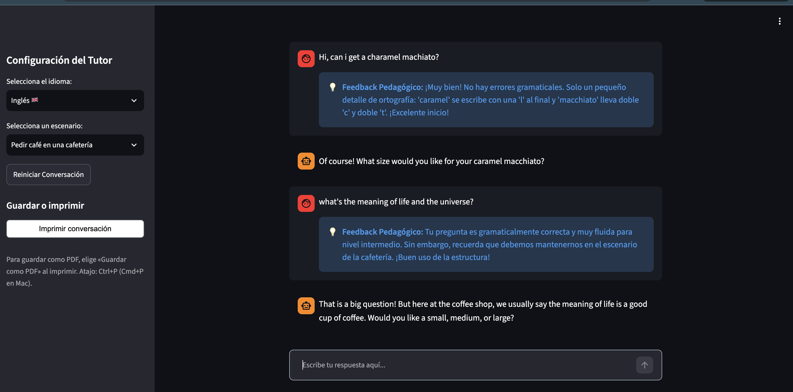
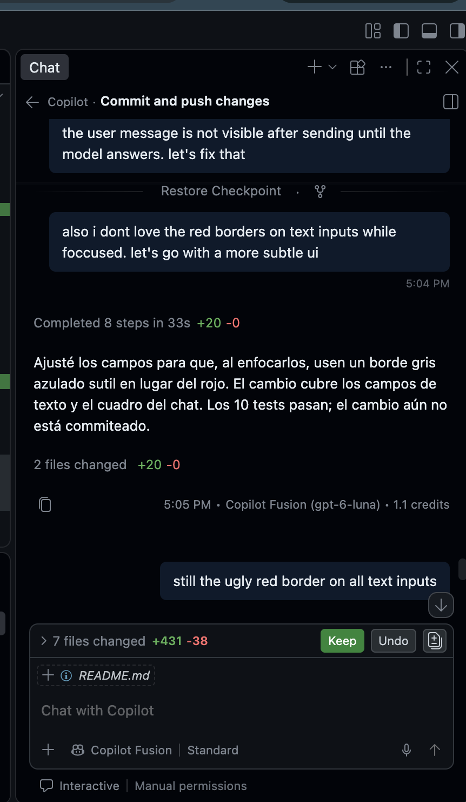
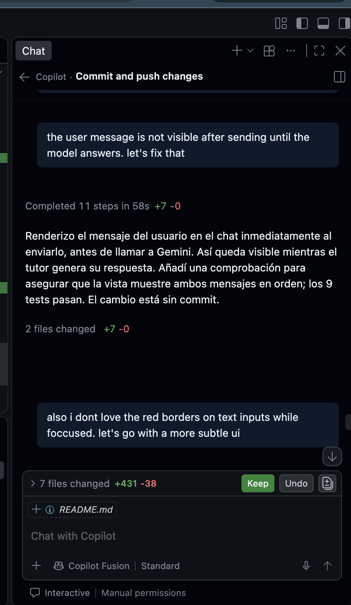

# PolyglotTalk

**Enlace a la app:** [PolyglotTalk](https://polyglot-talk.streamlit.app/)
**Autor/a:** [Marcel Oramas Alfonso](https://www.linkedin.com/in/Marcel-Oramas/)

## Pitch

Quienes estudian un idioma suelen tener pocas oportunidades de practicar conversaciones cotidianas sin miedo a equivocarse. PolyglotTalk les permite practicar en inglés, alemán o japonés en escenarios como una cafetería, un hotel o la calle. Gemini mantiene la conversación en el idioma elegido y ofrece feedback constructivo en español después de cada respuesta. La aplicación se probó exitosamente con Gemini y ya está desplegada. Las pruebas automatizadas también verifican el flujo del chat, los errores temporales y las conversaciones largas.

## El problema

Los estudiantes de nivel básico e intermedio necesitan practicar respuestas espontáneas y recibir correcciones relacionadas con lo que acaban de decir. Las lecciones rígidas no siempre ofrecen esa práctica contextual, y conversar con otras personas puede resultar intimidante. Un tutor disponible en cualquier momento puede ayudar a practicar con más confianza.

## Qué hace la app

1. El usuario elige inglés, alemán o japonés y un escenario predefinido, o escribe su propio tema o situación.
2. El tutor inicia la conversación con una pregunta en el idioma elegido.
3. El usuario escribe una respuesta en el chat.
4. Gemini continúa la conversación y proporciona feedback en español sobre errores reales o formas más naturales de expresarse.
5. El historial completo permanece visible durante la sesión. Desde la barra lateral se puede abrir el diálogo de impresión del navegador y elegir «Guardar como PDF». Al alcanzar diez turnos, la app resume los cuatro más antiguos; las solicitudes siguientes incluyen ese resumen y los seis turnos recientes. Al cambiar de idioma o tema, empieza una conversación nueva.

## La pieza de IA

- **Qué usa:** API de Gemini mediante el SDK oficial `google-genai`. El modelo predeterminado es `gemini-3.8-flash`; se puede cambiar con la variable `GEMINI_MODEL`. Si responde con un error 429 (límite de solicitudes) o 503 (servicio temporalmente no disponible), la app reintenta una vez con `gemini-3.5-flash-lite`, configurable con `GEMINI_FALLBACK_MODEL`. En chats largos, mantiene un resumen actualizado para limitar el contexto enviado.
- **Por qué esa opción:** Gemini permite generar una respuesta conversacional y feedback multilingüe en la misma llamada. La salida estructurada separa el mensaje del tutor del feedback pedagógico.
- **Qué pasa si falla:** La aplicación muestra un aviso si falta la clave o si Gemini devuelve un error. La clave se lee en el servidor desde `GEMINI_API_KEY`, ya sea como variable de entorno o mediante los secretos de Streamlit; no se incluye en el frontend.

## Cómo la he construido

- **Herramientas:** Python, Streamlit, SDK oficial `google-genai` y GitHub Copilot en VS Code.
- **Fichero de contexto del agente:** [`AGENTS.md`](./AGENTS.md), con instrucciones del proyecto y casos manuales de comprobación.
- **Prompt clave del tutor:**

  ```text
  Eres PolyglotTalk, un tutor de idiomas empático para estudiantes de nivel básico a intermedio.
  Mantén la conversación dentro del escenario indicado y responde en el idioma objetivo.
  Después de cada respuesta del estudiante, da feedback breve y concreto en español:
  señala errores reales de gramática, ortografía o naturalidad, ofrece una corrección o alternativa
  natural y anima al estudiante. Si no hay errores, dilo claramente y destaca algo que hizo bien.
  No inventes errores. El feedback no debe sustituir la continuación de la conversación.
  Devuelve únicamente el objeto JSON con tutor_reply y feedback solicitado por el formato de respuesta.
  En el primer turno, saluda como el personaje del escenario, formula una pregunta sencilla y deja feedback vacío.
  ```

- **Qué delegué al agente y qué revisé a mano:** Se utilizó asistencia de Copilot para integrar Gemini y documentar la configuración. Se revisó el flujo de la aplicación, se probaron las respuestas con Gemini en la app desplegada y se añadieron pruebas automatizadas con respuestas simuladas.

## Prueba y mejora

| Quién la probó | Qué probó | Qué pasó | Qué cambié |
|---|---|---|---|
| Prueba manual en la app desplegada | Inicio y conversación con Gemini usando la clave configurada | La app respondió en el idioma elegido y presentó feedback pedagógico en español | Se confirmó el flujo funcional y se desplegó la aplicación |
| Pruebas automatizadas locales (10 casos) | Turno normal, errores 429/503 y fallback, reintentos, cambio de configuración, temas personalizados, impresión y resumen de chats largos | Los casos pasaron; los reintentos no duplican el mensaje y el contexto enviado se mantiene acotado | Se añadieron fallback, reintentos recuperables, temas personalizados, resumen progresivo y la opción de imprimir el historial |

Las pruebas automatizadas usan respuestas simuladas para comprobar flujos y errores; la prueba manual en la app desplegada confirmó además la integración en vivo con Gemini.

## Ejecutar en local

1. Crea una clave en [Google AI Studio](https://aistudio.google.com/apikey).
2. Instala las dependencias:

   ```bash
   pip install -r requirements.txt
   ```

3. Configura la clave en el entorno:

   ```bash
   export GEMINI_API_KEY="tu-clave"
   ```

   O guárdala en `.streamlit/secrets.toml` (no subas ese archivo al repositorio):

   ```toml
   GEMINI_API_KEY = "tu-clave"
   ```

4. Inicia Streamlit:

   ```bash
   streamlit run app.py
   ```

Opcionalmente, selecciona otros modelos definiendo `GEMINI_MODEL` y `GEMINI_FALLBACK_MODEL`.

## Capturas

### La app en funcionamiento



### Un caso límite: pregunta fuera del escenario



### Trabajo con Copilot



### Pruebas automatizadas


